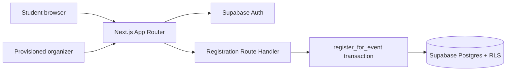

# Campus Event Pulse

Campus Event Pulse is a campus event discovery and registration app. Students can explore upcoming events and create accounts; the Supabase schema provides protected event management and transactional registrations for organizers.

> **Current implementation note:** the landing page and Explore page use a curated fictional preview catalog in `src/lib/events.ts` so the product has a useful first-run experience without database credentials. Authentication and the registration API are wired to Supabase. The organizer dashboard and event authoring UI are not yet included; organizer access is intentionally provisioned by an administrator. Connect Supabase and apply the migration before using database-backed account and registration flows.

## Features

- Responsive silver-blue interface with restrained soft-pink accents.
- Featured event cards and search/category filters.
- Event detail pages with date, venue, capacity, and availability.
- Supabase email/password sign-up and sign-in.
- Protected My Registrations page.
- Registration API backed by a Postgres RPC that serializes capacity checks per event.
- PostgreSQL constraints, indexes, role model, and Row Level Security policies.
- Fictional event preview data; no real institution affiliation is implied.

## Stack and architecture

- Next.js 14 App Router, React 18, TypeScript
- Supabase Auth, Postgres, SSR client
- Tailwind CSS configured for future component utilities; current design system lives in `src/app/globals.css`
- Route handlers in `src/app/api`



## Database overview

- `profiles`: one row per auth user; role defaults to `student`.
- `events`: organizer-owned event records with publication status and capacity.
- `registrations`: one row per student and event, with registered/cancelled state.
- `register_for_event(uuid)`: verifies session, publication, deadline, duplicate status, and available capacity while locking the event row. The unique constraint prevents duplicate registrations.

## Local setup

Requirements: Node.js 20+ and npm.

1. Clone this repository and install dependencies:

   ```bash
   npm install
   ```

2. Create a Supabase project. Copy `.env.example` to `.env.local` and fill in the project URL and anon key from **Project Settings → API**. Keep service-role keys server-only; the app does not need one for normal requests.

3. In the Supabase SQL Editor, run `supabase/migrations/202610240001_initial_schema.sql`.

4. In Supabase Auth settings, configure the local redirect URL (`http://localhost:3000/**`) and enable email/password sign-in. Email confirmation may be enabled or disabled for a demo.

5. Start the app:

   ```bash
   npm run dev
   ```

Visit <http://localhost:3000>.

## Organizer provisioning

Organizer access is not self-service. Create the account through Supabase Auth, then promote its profile from the trusted Supabase SQL Editor (substitute the auth user's UUID):

```sql
update public.profiles set role = 'organizer' where id = 'USER_UUID';
```

Only trusted project administrators should run this statement. Do not expose an endpoint that accepts a client-selected role. The current repository includes the database authorization model but does not yet ship organizer-facing event authoring pages.

## Registration and policies

Clients call `POST /api/register` with `{ "eventId": "<event uuid>" }`. The route obtains the authenticated user from the server-side Supabase session and calls `register_for_event`. The function locks the event row before counting active registrations, so simultaneous last-seat requests cannot both succeed. The client cannot insert registrations directly. Students can only read their own registrations and cancel their own rows; event owners can read participants for their events.

Apply the migration in a disposable Supabase project first, then verify RLS with two student accounts and two organizer accounts. SQL Editor runs with elevated privileges, so it is not a substitute for testing through the app's anon/authenticated client.

## Commands

```bash
npm run dev       # local development
npm run typecheck # TypeScript validation
npm run lint      # Next.js lint
npm run build     # production build
npm start         # run built app
```

## Deploy to Vercel

Import the GitHub repository in Vercel, set `NEXT_PUBLIC_SUPABASE_URL` and `NEXT_PUBLIC_SUPABASE_ANON_KEY` in project environment variables, apply the SQL migration to Supabase, then deploy. Add the production site URL to Supabase Auth redirect URLs. Never set a service-role key as a `NEXT_PUBLIC_` variable.

## Known limitations and next steps

- The featured catalog is a presentation preview and is not yet loaded from the events table.
- Organizer dashboard, event create/edit/publish, participant CSV export, and profile editing remain to be implemented.
- Registration API expects a database UUID. Create published event rows in Supabase before calling it; the current preview cards are fictional and are not database records.
- Cancellation endpoint is available at `POST /api/cancel-registration` with `{ "registrationId": "<uuid>" }`.
- Supabase-backed workflows require project credentials and have not been exercised against a live project in this environment.

## License

No license has been selected yet.
